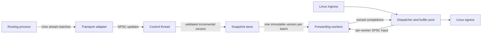

# Userspace Packet Forwarding Engine

A C++20 forwarding engine with Ethernet/IPv4/IPv6 parsing, longest-prefix lookup,
resolved next-hop groups, ECMP, multicore workers, and versioned control-plane
updates. Linux packet sockets provide a reference receive/transmit runtime.

The portable implementation is tested on macOS with release builds, address and
undefined-behavior sanitizers, and ThreadSanitizer. Linux GCC/Clang builds, sanitizer
suites, raw-socket loopback, and dual-stack veth forwarding also
[pass in CI](https://github.com/tejakusireddy/cpp-packet-forwarding-engine/actions/runs/38966703953).
The full performance targets are **not yet validated**.

## Build and run tests

Requires CMake 3.20+, a C++20 Clang/GCC compiler, and POSIX threads/sockets. Linux
is the deployment target; library tests and in-memory benchmarks also run on macOS.
No third-party C++ dependencies are required.

```sh
cmake -S . -B build -DCMAKE_BUILD_TYPE=Release
cmake --build build --parallel
ctest --test-dir build --output-on-failure

cmake -S . -B build-sanitize -DCMAKE_BUILD_TYPE=Debug -DENABLE_SANITIZERS=ON
cmake --build build-sanitize --parallel
ctest --test-dir build-sanitize --output-on-failure

cmake -S . -B build-thread -DCMAKE_BUILD_TYPE=Debug -DENABLE_THREAD_SANITIZER=ON
cmake --build build-thread --parallel
ctest --test-dir build-thread --output-on-failure
```

Address/undefined-behavior and thread sanitizers require separate build directories.
`BUILD_TESTING=OFF` omits tests; `BUILD_BENCHMARKS=OFF` omits the benchmark executable.

## Architecture



The reference executable installs startup routes and optionally starts a private
Unix routing listener with `--control PATH`. A transport thread sends requests to
the control queue; a separate control thread builds and publishes snapshots while
packet workers continue forwarding. The `route_ctl` client returns typed acknowledgments.

A packet follows this path:

1. Parse Ethernet and IP lengths without allocating or assuming aligned input.
2. Validate forwarding eligibility and IPv4 checksum before modifying any byte.
3. Hash the flow, find the longest matching prefix, and select an available ECMP member.
4. Decrement TTL/hop limit, update the IPv4 checksum, and rewrite Ethernet addresses.
5. Return the owned buffer and selected interface; the dispatcher transmits and recycles it.

Every rejected frame remains unchanged. Queue pressure preserves ownership; output
pressure holds a completion without forwarding it twice. Shutdown stops new input,
drains accepted work, and joins caller-owned threads.

Routing updates build a separate candidate snapshot. Unchanged trie nodes are
shared; only touched shared paths are copied. A batch names its expected base
version, so stale work cannot overwrite intervening changes. Publication swaps
FIB and adjacency tables together. Retired versions are collected on a control
thread after readers release them.

## Read the code and understand why

Start with the [code guide](docs/code-guide.md). It follows every source component,
explains its functions and important branches, and links the relevant tests.
The [design decisions](docs/design.md) explain alternatives and tradeoffs.
The [IPC protocol](docs/ipc-protocol.md) specifies every wire field.

| Component | Source | Main reason for the design |
| --- | --- | --- |
| Parser | `src/packet.cpp` | Borrow bytes; validate bounds before reads |
| FIB | `src/fib.cpp` | Bounded lookup; share unchanged snapshot paths |
| Adjacencies/ECMP | `src/next_hop.cpp` | Resolve off-path; select active members in constant time |
| Flow hash | `src/flow.cpp` | Stable mapping; keep IPv4 fragments together |
| Frame preparation | `src/forward.cpp` | Validate before mutation |
| SPSC queue | `include/forwarding/spsc_queue.hpp` | Bounded ownership transfer with explicit backpressure |
| Workers/pool | `include/forwarding/worker.hpp`, `packet_pool.hpp` | Reuse buffers and amortize snapshot acquisition |
| Snapshots | `src/snapshot.cpp` | Publish consistent tables; reclaim outside forwarding |
| Control batches | `include/forwarding/control.hpp` | All-or-nothing updates and ordered acknowledgments |
| Process transport | `src/ipc.cpp` | Bounded, versioned, portable wire representation |
| Live routing | `src/unix_socket.cpp`, `src/routing_service.cpp` | Private listener, deadlines, and control-thread isolation |
| Routing client | `src/routing_request.cpp`, `src/route_ctl.cpp` | Strict parsing and explicit version/conflict handling |
| Linux runtime | `src/linux_io.cpp`, `src/main.cpp` | Auditable packet I/O and flow dispatch |
| Measurement | `benchmarks/forwarding_bench.cpp` | Separate core, queue, route-scale, and update costs |

Public headers specify ownership, thread roles, errors, and lifetime requirements.
Comments explain non-obvious invariants; the guide supplies the surrounding
reasoning rather than repeating each C++ statement in a comment.

## Linux forwarding

Use dedicated test interfaces or the isolated integration environment. The runtime
does not configure host routing or interfaces. It requires `CAP_NET_RAW`:

```sh
sudo ./build/packet_forwarder IN_INTERFACE OUT_INTERFACE aa:bb:cc:dd:ee:ff 8
# Optional input count and first worker CPU; zero count runs until a signal.
sudo ./build/packet_forwarder IN_INTERFACE OUT_INTERFACE aa:bb:cc:dd:ee:ff 8 1000000 2

sudo ./build/linux_io_tests
sudo bash tests/linux_integration.sh
```

The destination MAC is explicit; source MAC and MTU come from the output interface.
Both IP families receive default routes to that adjacency. CPU pinning is opt-in
and requested unavailable CPUs cause startup failure. SIGINT/SIGTERM stops input
and drains accepted jobs. The veth test creates a temporary namespace, checks IPv4
and IPv6 forwarding, and removes the namespace on exit.

## Change routes while forwarding

Create a private directory owned by the account running the forwarder. The
listener refuses an existing socket or file rather than deleting it:

```sh
sudo install -d -m 700 /run/pfe
sudo ./build/packet_forwarder IN_INTERFACE OUT_INTERFACE aa:bb:cc:dd:ee:ff 8 \
  --control /run/pfe/routing.sock --control-timeout-ms 1000
```

The initial version is 1, with IPv4/IPv6 defaults using group 0. From another
terminal, submit changes with their expected base and new version:

```sh
sudo ./build/route_ctl /run/pfe/routing.sock 1 2 erase 0.0.0.0/0
sudo ./build/route_ctl /run/pfe/routing.sock 2 3 upsert 0.0.0.0/0 0
sudo ./build/route_ctl /run/pfe/routing.sock 3 4 upsert 2001:db8::/32 0
```

The client prints JSON containing requested version, current version, and status.
Exit codes are 0 applied, 1 rejected, 2 invalid command, and 3 transport/protocol
failure. `route_ctl --help` also describes single-member group updates. Group
updates must use the runtime's output interface index; they can change its
resolved MAC addresses or availability. Prefix changes may reference installed groups.

The socket is mode 0600 under a private directory, with one active client and a
listen backlog of four. Each connection accepts at most 64 requests; every message
has an absolute I/O deadline. The default server timeout is one second. Slow,
malformed, or disconnected clients are closed without stopping the listener.
An applied batch may have lost its acknowledgment after a disconnect; clients
must inspect version/conflict responses rather than automatically replaying it.
Acknowledgment confirms publication, not completion of all in-flight packet work.

Shutdown cancels socket waits, drains accepted control batches, then drains packet
workers. The listener removes only its own socket entry. After a crash, inspect
and remove a stale socket manually once no process is listening. See
[the protocol and lifecycle contract](docs/ipc-protocol.md).

## Performance evidence

```sh
./build/forwarding_bench --mode queued --workers 8 --packets 1000000 \
  --routes 1000000 --updates 100000 --batch 512
python3 scripts/benchmark.py --output benchmarks/results/local
```

Read the [benchmark protocol](docs/benchmarking.md) before interpreting results.
`core` excludes queues and uses a small active lookup set. `queued` includes
dispatcher/worker scheduling and walks the configured route table. Neither includes
NIC I/O. Updates are measured in a separate phase, excluding IPC serialization.
The [validation report](docs/validation.md) records measured results and remaining gates.

## Current boundaries

- Untagged Ethernet II, IPv4 without options on the forwarding path, and IPv6
  without recognized extension headers. The structural parser also accepts IPv4 options.
- No VLAN, jumbograms, ICMP generation, local delivery, address-policy checks,
  ARP/ND, weighted/resilient ECMP, or transport checksum validation.
- SPSC queues are lock-free on supported targets. Snapshot shared-pointer operations
  are not guaranteed lock-free. Slow readers can retain old routing memory.
- Process IPC uses filesystem ownership as its local authorization boundary. It
  does not expose a network listener or implement automatic retry after lost acks.
- AF_PACKET is a syscall-based reference backend. Packet rings, NIC steering,
  batched socket I/O, and wire-level performance validation remain future work.
- Million-route scale and update throughput have local benchmark evidence. The
  queued sub-10µs p99 target, Linux eight-core results, and simultaneous forwarding
  under update load remain open acceptance gates.
